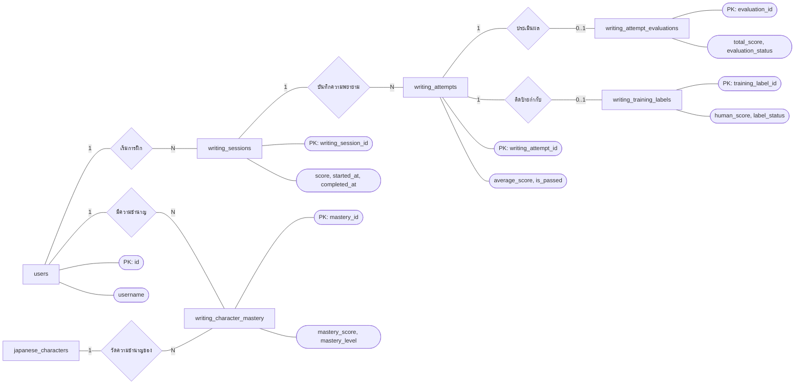
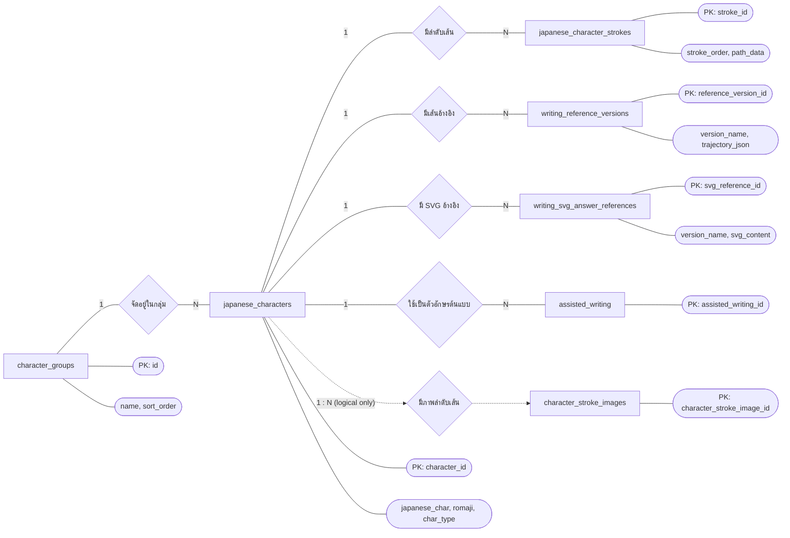
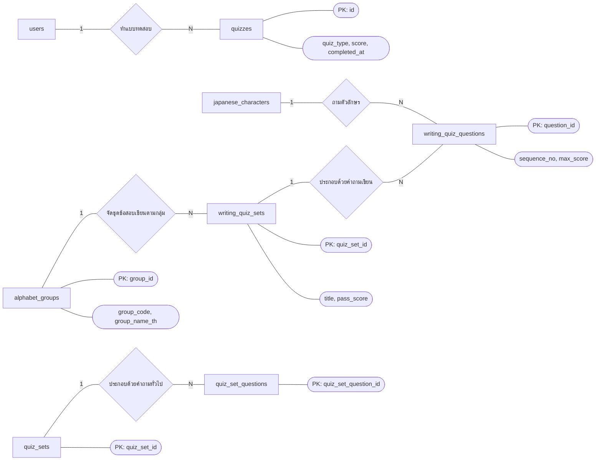
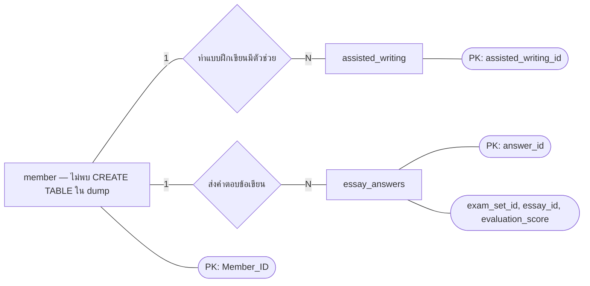

# Chen ER Diagram — jp_learning

จัดทำจาก `jp_learning.sql` เพื่ออธิบายโครงสร้างเท่านั้น ไม่มีการแก้โค้ดหรือฐานข้อมูล

สัญลักษณ์แบบ Chen: **สี่เหลี่ยม** = Entity/ตาราง, **ข้าวหลามตัด** = Relationship, **วงรี** = Attribute, และเลข `1`, `N` บนเส้น = Cardinality

## 1) ผู้ใช้และการฝึกเขียน

## 2) ข้อมูลตัวอักษรญี่ปุ่นและสื่อประกอบ

## 3) ชุดข้อสอบ

## 4) ความสัมพันธ์เดิมที่ปลายทางหายไปจากไฟล์ SQL

`member` ถูกอ้างอิงด้วย Foreign Key ใน `assisted_writing` และ `essay_answers` แต่ไม่มีคำสั่งสร้างตารางนี้ใน dump จึงควรตรวจสอบไฟล์ export ต้นทางหากต้องการ ER Diagram ที่ครบถ้วน

## 5) ตารางสนับสนุนหรือความสัมพันธ์ที่ SQL ยังไม่บังคับ

| ตาราง | หมายเหตุ |
|---|---|
| `admin` | ถูกอ้างอิงโดยฟิลด์ `created_by_admin_id` / `updated_by_admin_id` หลายจุด แต่ไม่มี Foreign Key |
| `admin_writing_test_users` | `user_id` อ้างถึง `users` จริง; `admin_id` เป็น PK แต่ไม่มี FK ไป `admin` |
| `character_stroke_images` | มี `character_id` และ `created_by_admin_id` แต่ไม่มี Foreign Key |
| `quiz_format` | ตารางกำหนดรูปแบบแบบทดสอบ ไม่มี Foreign Key |
| `writing_answer_references` | มี `character_id` แต่ไม่มี Foreign Key |
| `writing_scoring_settings` | ตารางตั้งค่าน้ำหนักคะแนน ไม่มี Foreign Key |
| `writing_svg_stroke_images` | เชื่อมเชิงตรรกะด้วย `character_id` และ `version_name` แต่ไม่มี Foreign Key |
| `writing_variant_styles` | ตารางรายการสไตล์ ไม่มี Foreign Key |

เส้นประในแผนภาพหมายถึงชื่อคอลัมน์บ่งชี้ความสัมพันธ์ แต่ฐานข้อมูลยังไม่ได้ประกาศ Foreign Key จึงไม่ควรตีความว่าเป็นความสัมพันธ์ที่ระบบบังคับอยู่จริง
